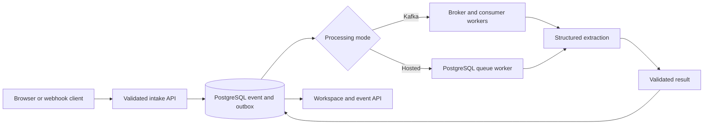

# OmniStream AI

**Turn webhooks and document text into structured, inspectable intelligence.**

OmniStream is an asynchronous ingestion engine with a browser workspace for watching AI turn raw input into a summary, category, risk assessment, sentiment score, and actionable entities. Every submission receives an event ID and a persistent processing state, so you can follow it from intake to the saved result.

Built with Java 21, Spring Boot, PostgreSQL, Apache Kafka, and Groq Cloud.

## What you can do

- **Analyze text and webhooks.** Paste a payload, load a text file, or submit JSON through the REST API.
- **Watch the workflow.** The AI workspace displays ingestion, analysis, and saved-result stages driven by the event’s actual server status.
- **Inspect useful output.** Review a concise summary, category and risk tags, sentiment, extracted key/value pairs, and expandable structured JSON.
- **Trace the original input.** Open an event to compare its raw payload, metadata, timestamps, processing state, and analysis.
- **Explore the stream.** Search by source, event type, or ID and filter by status.
- **Monitor recent activity.** The overview shows intake volume, category distribution, completed events, failures, and work in flight.
- **Start with examples.** Invoice, incident-report, and sensor-alert examples demonstrate different extraction tasks. The Help tab explains the workflow.
- **Choose a deployment model.** Use Kafka for the distributed pipeline or PostgreSQL-backed queuing for a smaller hosted installation.

## A typical workflow

1. Open the landing page and enter the workspace.
2. Connect with the deployment’s service API key. The Windows app connects automatically with its local development key.
3. Open **AI workspace**, choose an example, or paste your own text.
4. Select **Analyze payload**. Intake saves the event before analysis begins.
5. Follow its progress and inspect the completed result. The event remains available in **Event stream**.

The interface shows the configured provider and model. While work is pending, it displays loading feedback and elapsed waiting time. Completed results show end-to-end event duration. If a status request fails, **Check status** resumes inspection of the accepted event.

## What AI extracts

| Field | Meaning |
| --- | --- |
| `summary` | A factual description of the payload |
| `category` | `FINANCIAL`, `SYSTEM_LOG`, `IOT_TELEMETRY`, or `UNKNOWN` |
| `sentiment_score` | A numeric score from −1 to +1 |
| `risk_level` | `LOW`, `MEDIUM`, `HIGH`, or `CRITICAL` |
| `actionable_entities` | Key/value pairs supported by the source text |

For example, an overdue invoice can yield its invoice ID, amount, currency, and payment status. An incident report can yield a service, host, region, error rate, and recovery action. Results depend on the supplied text and the active parser.

### Provider modes

| Mode | Behavior |
| --- | --- |
| `groq` | Default. Groq Cloud with `openai/gpt-oss-120b` |
| `openai` | Optional OpenAI adapter with a configurable model |
| `local` | Deterministic keyword and labeled-field extraction for offline demonstrations |

The Groq adapter requests strict JSON Schema output using medium reasoning effort, a 2,048-token completion budget, and a non-streaming response. It validates the returned data before saving it. Provider errors, incomplete responses, and invalid results enter the retry path.

Raw payloads and metadata are sent to the selected AI provider in cloud parser modes. Provider credentials stay on the server.

## Architecture



The event and its outbox entry commit in one database transaction. The API then returns `202 Accepted`. Analysis runs asynchronously.

| Event state | Meaning |
| --- | --- |
| `RECEIVED` | Input is saved and waiting for processing |
| `PROCESSING` | A worker has started analysis |
| `COMPLETED` | Validated analysis is saved |
| `FAILED` | Processing retries were exhausted |

The acceptance response uses `PENDING` as its receipt status.

### Kafka processing

The relay publishes confirmed outbox batches to `raw-ingestion-events`. Three consumer threads share `omnistream-processing-group`. The producer uses idempotence and `acks=all`; consumers acknowledge after the database result commits.

After an initial failure and three exponentially delayed retries, recovery publishes to `raw-ingestion-events.DLQ` and marks the event failed. Terminal events skip repeated analysis on redelivery.

### Hosted processing

The `hosted` profile consumes the durable PostgreSQL outbox directly. Workers claim due entries with row locks and a 90-second lease. Failed analysis receives up to three retries. Exhausted events retain their payload and failed state for inspection.

Use one queue mode per database. Delivery is at least once. A crash between a provider call and the result commit can repeat the provider call. Each new HTTP submission receives a new UUID.

## Technical stack

| Component | Implementation |
| --- | --- |
| Runtime | Java 21 |
| Application | Spring Boot 3.5.11 |
| Persistence | Spring Data JPA, PostgreSQL, JSONB |
| Migrations | Flyway |
| Messaging | Spring Kafka; Apache Kafka 3.9.1 in Compose |
| AI transport | Java HTTP client with typed response validation |
| API security | Spring Security and `X-API-KEY` authentication |
| Rate limiting | Resilience4j, 50 requests/second per peer IP per instance |
| API documentation | Springdoc OpenAPI and Swagger UI |
| Observability | Actuator health, readiness, liveness, and metrics |
| Frontend | Responsive HTML, CSS, JavaScript, and Canvas |
| Testing | JUnit, Mockito, RestAssured, Awaitility, Testcontainers |
| Build | Maven and a multi-stage Dockerfile |

## Run locally

### Docker Compose

Create `.env` from `.env.example` and supply `GROQ_API_KEY`.

```sh
docker compose up --build -d --wait
```

Open `http://localhost:8080`. Compose starts the app, PostgreSQL, and Kafka with persistent database and broker volumes. Set `PARSER_MODE=local` for an offline run.

```sh
docker compose logs -f app
docker compose down
```

### Java

Use JDK 21+ and Maven 3.9+.

```sh
mvn clean package -DskipTests
java -jar target/omnistream-ai.jar
```

Configure PostgreSQL and credentials through the environment. Select `SPRING_PROFILES_ACTIVE=hosted` for PostgreSQL queuing. Kafka-based profiles also require a reachable broker.

### Windows launcher

The separately packaged `Omnistream-Windows.jar` starts the local services and opens the browser after readiness succeeds. It selects an installed Java 21+ runtime and requires PostgreSQL 16+ tools.

Keep the launcher window open and press **Q** to stop. Data and logs live beside the JAR in `Omnistream-data/state`. The launcher reads `GROQ_API_KEY` or a credential encrypted for your Windows account. Without either, it starts the local parser. The source includes launcher packaging and credential-setup scripts under `windows/`.

## Deploy the complete web app

The included `render.yaml` configures a Free Render web service. A Neon PostgreSQL database provides persistent storage.

1. Create a Neon database and collect its hostname, database name, user, and password.
2. In Render, choose **New → Blueprint** and connect this repository.
3. Supply `DB_URL`, `DB_USER`, `DB_PASSWORD`, and `GROQ_API_KEY`. Use a JDBC URL such as `jdbc:postgresql://HOST/DATABASE?sslmode=require`.
4. Deploy. Render generates the service `API_KEY` and activates the `hosted` profile.
5. Open the public URL, enter the workspace, and connect with the generated service key.

Flyway creates the schema at startup. The deployed application serves both the landing page and workspace. The service key grants access to the shared event workspace.

Netlify and Vercel configuration files also support a static sample preview. Setting `WORKSPACE_ORIGIN` during that frontend build links it to a live backend. Full ingestion, provider calls, and persistence require the backend deployment.

Free hosting is subject to provider quotas and idle suspension. The optional Heroku manifest provisions paid resources. Check the selected provider’s current plan before deploying.

## Configuration

| Variable | Purpose |
| --- | --- |
| `SPRING_PROFILES_ACTIVE` | `hosted` for PostgreSQL queuing, `dev` for local Kafka, or `prod` for configured Kafka deployments |
| `DB_URL` | PostgreSQL JDBC URL |
| `DB_USER`, `DB_PASSWORD` | Database credentials |
| `API_KEY` | Service authentication secret |
| `PARSER_MODE` | `groq`, `openai`, or `local` |
| `GROQ_API_KEY`, `GROQ_MODEL` | Groq credential and model |
| `OPENAI_API_KEY`, `OPENAI_MODEL` | Optional OpenAI credential and model |
| `KAFKA_BROKERS` | Kafka bootstrap servers |
| `KAFKA_REPLICATION_FACTOR` | Topic replication factor, default 1 |
| `PORT` | HTTP listen port, default 8080 |
| `HTTP_PORT` | Compose host port |
| `WORKSPACE_ORIGIN` | Live workspace origin for a static frontend build |

## API

All event endpoints require `X-API-KEY`.

| Method | Endpoint | Purpose |
| --- | --- | --- |
| `POST` | `/api/v1/events/ingest` | Accept an event asynchronously |
| `GET` | `/api/v1/events/{id}` | Read the event and analysis |
| `GET` | `/api/v1/events` | List the latest 100 events and active parser configuration |

Example request body:

```json
{
  "sourceId": "ledger-api",
  "eventType": "invoice.received",
  "rawPayload": "Invoice INV-42 for USD 85.00 is overdue.",
  "metadata": {
    "region": "west"
  }
}
```

A successful intake response contains `eventId`, `status`, and `timestamp`. Its `Location` header points to the event.

Payloads support up to 65,536 characters. Metadata supports up to 32 string key/value pairs. Overview counts and charts cover the latest 100 events. The console refreshes its feed every four seconds and polls an active AI analysis every second.

## Health and diagnostics

| Endpoint | Purpose |
| --- | --- |
| `/swagger-ui.html` | Interactive API reference |
| `/actuator/health/readiness` | Database readiness and Kafka connectivity in Kafka modes |
| `/actuator/health/liveness` | Application liveness |
| `/actuator/metrics` | Authenticated operational metrics |

Rate limits use the socket peer IP. A reverse proxy can cause multiple clients to share that address.

## Verification

```sh
mvn test
mvn verify
mvn verify -DlatencyCheck=true
```

Unit tests cover worker acknowledgments and the provider response contract. Integration tests exercise acceptance, JSONB persistence, broker delivery, duplicate handling, authentication, retry exhaustion, dead-letter recovery, and PostgreSQL-only hosted processing. Testcontainers verification requires Docker.

The optional latency test checks warm loopback intake against a median under 30 ms and a p95 under 50 ms. These are test thresholds for intake.

For an explicitly enabled live Groq contract check:

```sh
mvn -DgroqLiveTest=true -Dtest=GroqLiveContractTest test
```

Supply `GROQ_API_KEY` in the environment. The test sends a synthetic invoice and validates the extracted identifier.
